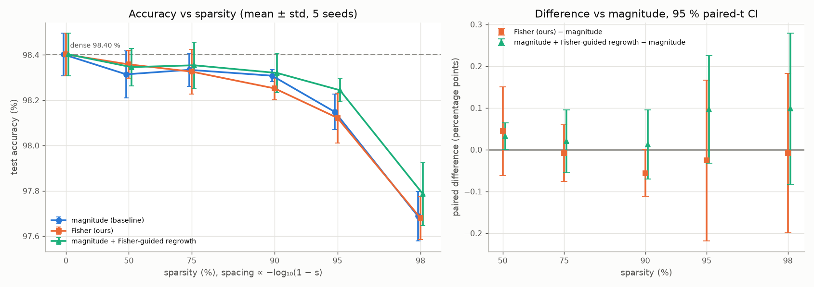
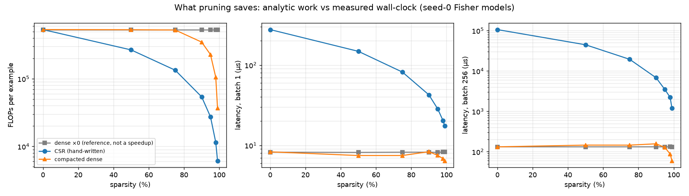

# Budbæreren

*Budbæreren* (Norwegian: "the messenger") is a small neural-network library
written from scratch in pure Python + NumPy, and an MNIST classifier built
on it that **prunes its own connections during training** to a hard
sparsity budget, while keeping autodiff and optimizer state correct as the
graph changes underneath it.

**Headline:** at **90 % sparsity** the network keeps **98.31 % ± 0.03** test
accuracy (magnitude) / 98.25 % ± 0.05 (Fisher) against 98.40 % dense, with
**9.9× fewer FLOPs** per example. At **98 %** it keeps 97.7 % with 46.5× fewer
FLOPs. The loss-derived Fisher criterion did **not** beat magnitude pruning
beyond seed noise, and the README says so (see [the claim](#the-falsifiable-claim)).

| | |
|---|---|
| Design reasoning | [DESIGN.md](DESIGN.md): masked-weight gradients, the importance criterion, bottlenecks, serving at scale |
| Build log | [docs/IMPLEMENTATION.md](docs/IMPLEMENTATION.md): ten phases, each with plan, diagrams, results and notes |
| Raw numbers | [results/](results/): every committed figure has its CSV next to it |

## Library policy

- **NumPy** throughout; **Matplotlib** for plots.
- **scikit-learn is used only to download MNIST** (`sklearn.datasets.fetch_openml`,
  in `budbaereren/train/data.py`). It is not used for training, models,
  preprocessing, metrics or gradients. (It pulls in SciPy as a transitive
  dependency; SciPy is never imported.)
- No PyTorch, TensorFlow, JAX, Keras, HuggingFace, or any autodiff /
  pruning / neural-network library. The autodiff engine, backward pass,
  pruning mechanism, optimizers, training loop, sparse kernels and statistics
  are all in `budbaereren/`.
- The policy is enforced by a test (`tests/test_library_policy.py`) that
  parses every module and fails on a forbidden import.

## Install

Requires [uv](https://docs.astral.sh/uv/) (Python 3.12 is fetched automatically;
any Python ≥ 3.10 works).

```bash
git clone https://github.com/KazukiNoSuzaku/Project-Budb-reren.git
cd Project-Budb-reren
uv sync
```

The first command that needs data downloads MNIST from OpenML (~15 MB, once)
into `data/mnist.npz` and verifies it against a SHA-256 checksum.

## Reproduce

| what | command | time* |
|---|---|---|
| **Gradient-check tests** (Part 1) | `uv run pytest tests/test_gradcheck.py` | < 1 s |
| Full test suite (incl. masked-weight correctness) | `uv run pytest` | ~2 s |
| **Part 2:** dense training + learning curve | `uv run python scripts/train_dense.py` | ~15 s |
| **Part 3:** self-pruning run (Fisher → 90 %) | `uv run python scripts/train_prune.py` | ~25 s |
| Part 3 variants | `uv run python scripts/train_prune.py --target 0.98 --criterion magnitude --regrow 0.3` | ~30 s |
| **Part 4:** Pareto sweep (80 runs) | `uv run python scripts/sweep.py && uv run python scripts/analyze_sweep.py` | ~35 min |
| Part 4: cost benchmark | `uv run python scripts/benchmark_cost.py` | ~1 min |
| Supporting: criterion selection / ablations | `uv run python scripts/select_criterion.py` / `scripts/ablations.py` | ~10 / ~15 min |
| Supporting: masking evidence, re-plot all figures | `uv run python scripts/masking_evidence.py` / `scripts/replot.py` | seconds |

\*Apple-silicon laptop, single process. `sweep.py` is resumable, and
`sweep.py --quick` runs a 1-minute smoke version. All seeds are fixed;
re-running a script reproduces its committed CSV.

## Results

### Part 1: autodiff that survives a changing graph

- 29 parametrised finite-difference gradient checks (every op, broadcasting
  variants, composite networks, a masked layer). Worst norm-wise relative
  error: 1.1e-10, test threshold 1e-7. A planted bug is caught.
- **Masked weights** (`tests/test_masking.py`, `results/masking_evidence.csv`):
  the forward pass uses `W ⊙ M`, so `∂L/∂W` is exactly 0 for pruned entries
  while the dense gradient `∂L/∂(W⊙M)` is kept for regrowth. The optimizer
  freezes pruned entries' state bit-for-bit and, on revival, restarts that
  entry's Adam state **including its own step counter**:

  | variant | drift while pruned | first step after revival |
  |---|---:|---:|
  | **Budbæreren Adam** | **0** | **+1.000 lr** (= a fresh parameter) |
  | naive: mask the gradient only | 0.069 | n/a |
  | naive: no state reset | 0 | −0.800 lr (wrong direction) |
  | naive: reset `m, v`, global `t` | 0 | +3.152 lr |

  Derivations are in [DESIGN.md §1](DESIGN.md#1-the-gradient-of-a-masked-weight).

### Part 2: dense training

784-300-100-10 ReLU MLP, He init (hidden) / Xavier (output), Adam lr 1e-3
with cosine decay, batch 128, 20 epochs: **98.30 % test accuracy**, no NaNs
(the loop raises on the first non-finite loss).
[`results/part2/`](results/part2/)


### Part 3: self-pruning

Importance criterion (`fisher`): `½ w² · E[g²]`, the second-order Taylor
term of the loss change from removing a weight (Optimal Brain Damage), with
the Hessian diagonal approximated by an EMA of squared gradients
([DESIGN.md §2](DESIGN.md#2-the-importance-criterion)). Zhu & Gupta cubic
schedule from epoch 1 to 12, a prune event every 100 steps, global
allocation with exact counts, then fine-tuning on a frozen mask. Optional
RigL-style regrowth guided by the Fisher information of dead connections.

`scripts/train_prune.py` (Fisher → 90 %): **98.28 % test at exactly 90.00 %
sparsity** (26,620 of 266,200 weights; layer densities 7 % / 31 % / 80 %).
[`results/part3/`](results/part3/)


### Part 4: evidence

**Pareto sweep**: 5 seeds × {magnitude, Fisher, magnitude + regrowth} ×
{50, 75, 90, 95, 98} % plus dense; raw numbers in
[`results/part4/sweep.csv`](results/part4/sweep.csv), summary in
[`pareto.csv`](results/part4/pareto.csv).

| sparsity | magnitude | Fisher (ours) | magnitude + regrowth |
|---:|---:|---:|---:|
| 0 % | 98.40 ± 0.09 | 98.40 ± 0.09 | 98.40 ± 0.09 |
| 50 % | 98.31 ± 0.10 | 98.36 ± 0.06 | 98.35 ± 0.08 |
| 75 % | 98.33 ± 0.07 | 98.33 ± 0.10 | 98.35 ± 0.10 |
| 90 % | 98.31 ± 0.03 | 98.25 ± 0.05 | 98.32 ± 0.09 |
| 95 % | 98.15 ± 0.08 | 98.12 ± 0.11 | 98.24 ± 0.05 |
| 98 % | 97.69 ± 0.11 | 97.68 ± 0.10 | 97.79 ± 0.14 |



**Real cost** ([`results/part4/cost.csv`](results/part4/cost.csv)): a
hand-written CSR forward pass does exactly `2·nnz` FLOPs per layer with
identical predictions: 9.9× fewer FLOPs at 90 %, 46.5× at 98 %. **Honest
caveat:** in pure NumPy that CSR path is *slower* than dense BLAS at every
sparsity measured (e.g. 43 µs vs 8 µs per example at 90 %), because BLAS is
a tuned multi-threaded kernel and the CSR path is gather + segmented sum in
NumPy calls. The real wall-clock win comes from **structured compaction**
(deleting inputs and units that pruning fully disconnected, then dense BLAS
on smaller matrices): **1.5× faster at batch 256** at 98 % sparsity
(373-111-90-10 instead of 784-300-100-10), and slower than plain dense at
90 %. The dense-times-zero path is reported only as the reference and is
not counted as a speedup.



**Baseline comparison** (paired by seed: identical init, data order and
schedule; only the criterion changes). Pre-registered decision rule: a
difference is real if the 95 % paired-t CI over the 5 seeds excludes 0
([`comparison.csv`](results/part4/comparison.csv),
[`claims.md`](results/part4/claims.md)).

| at 98 % sparsity | paired diff | 95 % CI | seed wins | verdict |
|---|---:|---:|---:|---|
| Fisher − magnitude (**primary**) | −0.008 pp | [−0.199, +0.183] | 2/5 | tie: within seed noise |
| (magnitude + regrowth) − magnitude | +0.098 pp | [−0.083, +0.279] | 4/5 | within seed noise |

Between-seed std is ≈ 0.1 points, and five paired seeds resolve differences
of about ±0.2 points at 98 %. The criterion was chosen on *validation*
data with separate seeds (where Fisher led by 0.16); the fresh test-set
seeds show that lead was noise. Ablations (validation) show what does
matter: gradual vs one-shot pruning is worth 4.6 points at 98 %, EMA-smoothed
scores 0.9, global vs layer-wise allocation 0.4–0.8.

### The falsifiable claim

> At 98 % sparsity (5,324 of 266,200 weights, 46.5× fewer FLOPs per
> example), self-pruned LeNet-300-100 reaches **97.68 % ± 0.10** test
> accuracy with the Fisher criterion and **97.69 % ± 0.11** with magnitude
> pruning, averaged over 5 seeds, against 98.40 % dense. The paired
> Fisher − magnitude difference is **−0.01 percentage points, 95 % CI
> [−0.20, +0.18]**: on this task and budget, the gradient-based criterion
> does not beat magnitude by more than 0.2 points.
>
> Data: [`results/part4/sweep.csv`](results/part4/sweep.csv) ·
> [`results/part4/comparison.csv`](results/part4/comparison.csv) ·
> reproduce with `uv run python scripts/sweep.py && uv run python scripts/analyze_sweep.py`.


## Repository layout

```
budbaereren/
  engine/   tensor.py (Tensor, backward), ops.py (all ops), grad_check.py
  nn/       module.py (Module, Parameter+mask), layers.py (masked Linear), mlp.py, init.py
  optim/    optimizer.py (masking contract), adam.py, sgd.py
  prune/    criteria.py, schedule.py, pruner.py, regrowth.py
  sparse/   csr.py, inference.py (dense/CSR/compact), flops.py
  train/    data.py (only sklearn use), loop.py, experiment.py, stats.py, metrics.py
scripts/    one entry point per experiment (table above)
tests/      gradcheck, broadcasting, masking, optim, nn, pruning, regrowth, sparse, stats, policy
results/    part2/ part3/ part4/: CSV + figures + JSON for every reported number
docs/       IMPLEMENTATION.md
DESIGN.md
```

## References

- LeCun, Denker & Solla (1990), *Optimal Brain Damage*: second-order saliency.
- Han, Pool, Tran & Dally (2015), *Learning both Weights and Connections*: magnitude pruning, LeNet-300-100.
- Zhu & Gupta (2017), *To prune, or not to prune*: the cubic sparsity schedule.
- Lee, Ajanthan & Torr (2019), *SNIP*: gradient-based connection sensitivity.
- Molchanov et al. (2019), *Importance Estimation for Neural Network Pruning*: Taylor criteria.
- Evci et al. (2020), *Rigging the Lottery*: dynamic sparse training with regrowth.
- Kingma & Ba (2015), *Adam*; Loshchilov & Hutter (2019), *AdamW*.
- He et al. (2015) and Glorot & Bengio (2010): initialisation.
- Engine design informed by Karpathy's *micrograd* and similar NumPy autodiff projects (no code taken).
