# Budbæreren — Implementation Log

A phase-by-phase record of how Budbæreren was built: what each phase set out
to do, what was actually implemented, and *why* each decision was made.
Every phase starts with a **Plan** (written before any code for that phase)
and ends with **Notes** (written after the phase was finished and tested).

The git history mirrors this document: each phase lives on its own branch
(`phase-N-<slug>`), is merged into `main` with `--no-ff`, and is tagged
`v0.N-<slug>`.

| Phase | Branch | Scope |
|---:|---|---|
| 0 | `phase-0-scaffold` | Repository, tooling, package skeleton |
| 1 | `phase-1-engine-core` | Tensor, computation graph, backward, broadcasting |
| 2 | `phase-2-ops-gradcheck` | Full op set, fused softmax-CE, gradient checking |
| 3 | `phase-3-nn-optim-masking` | Layers, mask-aware SGD/Adam, masked-weight test |
| 4 | `phase-4-training` | MNIST pipeline, training loop, dense baseline |
| 5 | `phase-5-pruning` | Importance criteria, cubic schedule, self-pruning |
| 6 | `phase-6-regrowth` | RigL-style regrowth, mask churn, ablations |
| 7 | `phase-7-sparse-cost` | CSR forward, FLOPs, compaction, wall-clock |
| 8 | `phase-8-evidence` | Pareto sweep, multi-seed baseline, statistics |
| 9 | `phase-9-docs` | README, DESIGN.md, clean-clone reproduction |

---

## Phase 0 — Scaffolding

### Plan

**Goal:** a repository that anyone can clone and run `uv run pytest` on, with
a package layout that already reflects the final architecture so later phases
only *add* files.

Decisions taken up front:

- **Import name `budbaereren`, display name Budbæreren.** `æ` is a legal
  Python identifier (PEP 3131), but pip name normalisation, wheel filenames
  and some tooling handle non-ASCII badly. ASCII import name, Norwegian
  display name.
- **`uv` + `pyproject.toml` + committed `uv.lock`.** The lockfile pins every
  transitive dependency, which is a precondition for "clone and reproduce
  our numbers".
- **Python 3.12** pinned via `.python-version` (the brief requires ≥ 3.10).
- **Runtime dependencies are deliberately minimal:** NumPy (everything),
  Matplotlib (plots), scikit-learn (*only* `fetch_openml` to download MNIST).
  No SciPy — not even for statistics — so there is no question about which
  library did the work.
- **Original brief and private notes are git-ignored.** The repository
  contains only the submission.

### Target architecture

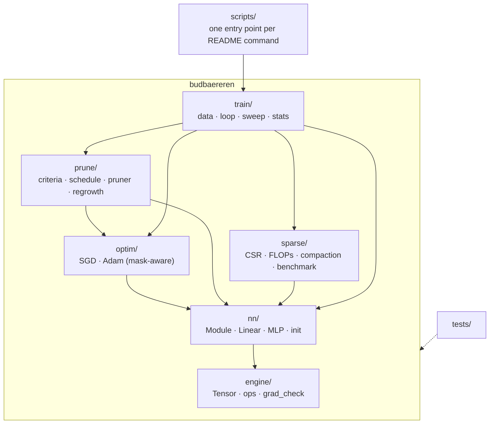

Dependencies only point *downwards*: `engine` knows nothing about layers,
`nn` knows nothing about pruning. This is what lets the masked-weight
guarantees be tested in isolation at each level.

### Notes

- `uv sync && uv run pytest` works from a clean clone; `uv.lock` is committed.
- scikit-learn pulls in SciPy transitively. Because "installed" is not the
  same as "used", `tests/test_library_policy.py` parses every module in
  `budbaereren/` with `ast` and fails if any of torch / tensorflow / jax /
  keras / transformers / scipy / autograd is imported, or if `sklearn` is
  imported anywhere other than `budbaereren/train/data.py`. The policy is
  enforced by CI-style test rather than by promise.
- `seed_everything` seeds the global RNGs as a safety net, but all library
  code takes an explicit `np.random.Generator` so that experiments never
  share hidden RNG state.

---

## Phase 1 — Autodiff core: Tensor, graph, backward, broadcasting

### Plan

**Goal:** a reverse-mode autodiff core that is small enough to explain on a
whiteboard and structured so that *adding an op is one function*.

Design decisions:

1. **`Tensor` wraps a NumPy array** and records `_parents` plus a
   `_backward` closure. Each op's backward is a *pure function*
   `upstream_grad -> tuple(grad_per_parent)`; it never mutates parent state.
   The engine, not the op, owns accumulation. This makes ops trivially
   testable and makes it impossible for an op to forget `+=`.
2. **Gradients accumulate in a per-call dictionary** keyed by node, then
   are written to `.grad`. Leaves *accumulate* across `backward()` calls
   (needs `zero_grad`, like PyTorch); intermediates are only populated when
   explicitly asked for via `retain_grad()` (Phase 3 needs this to read the
   dense gradient of a masked weight for regrowth).
3. **Iterative topological sort.** Recursive DFS hits Python's recursion
   limit on deep graphs; an explicit stack does not.
4. **One `unbroadcast(grad, shape)` helper**, used by every binary op. NumPy
   broadcasting in the forward pass implicitly *copies* a value along new or
   size-1 axes; the adjoint of a copy is a *sum*, so the backward sums the
   upstream gradient over exactly those axes.
5. **Dtype discipline.** Python scalars adopt the dtype of the tensor they
   meet (float32 training stays float32); integer inputs are promoted to
   float64. Gradient checking runs entirely in float64.
6. **`no_grad()` context** so evaluation does not build graphs.

Ops in this phase: `+ − × ÷`, negation, and their reflected forms. The rest
(matmul, reductions, non-linearities, softmax-CE) follow in Phase 2 together
with numerical gradient checking.

### Architecture

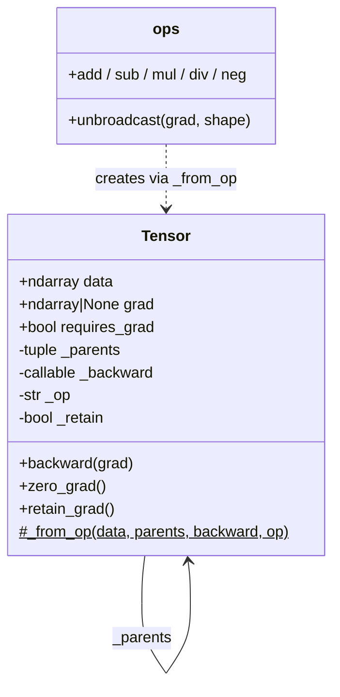

How `backward()` walks the graph for `loss = (x * w + b)` with
`x: (N, D)`, `w: (D,)`, `b: (D,)`:

### Notes

- **Why a per-call gradient dictionary instead of `node.grad += ...` inside
  every op?** It removes a whole class of bugs. An op's backward is a pure
  function of the upstream gradient, so it is testable in isolation, and
  accumulation for reused nodes (`x * x`, diamonds) happens in exactly one
  place. `test_reused_node_accumulates_gradient` would fail with `=`.
- **Leaves vs intermediates.** Leaves accumulate across `backward()` calls
  (standard semantics: the optimizer zeroes them). Intermediates are
  overwritten and only stored when `retain_grad()` is set; Phase 3 uses this
  to read `∂L/∂(W⊙M)` — the *dense* gradient of the effective weight — which
  is what regrowth needs, while the parameter itself gets `∂L/∂W = ∂L/∂(W⊙M) ⊙ M`.
- **Graph pruning at construction.** `_from_op` only records parents when
  some parent requires grad and grad mode is on, so constants (data, masks,
  labels) never enter the graph and `no_grad()` evaluation allocates nothing
  but results.
- **Broadcast test independence.** The reference gradient in
  `test_broadcast.py` is computed by scatter-adding each output position
  back to the element it was copied from, *not* by calling `unbroadcast`, so
  the test cannot pass by agreeing with its own bug.
- **`__array_priority__`** makes `ndarray * Tensor` dispatch to
  `Tensor.__rmul__` rather than NumPy trying to broadcast over a Tensor
  object.

---

## Phase 2 — Full op set, fused softmax-cross-entropy, gradient checking

### Plan

**Goal:** every op the brief requires, each verified against finite
differences by an automated, parametrised test.

Ops to add:

| Op | Backward (upstream `g`) |
|---|---|
| `matmul(A, B)` (2-D) | `∂A = g Bᵀ`, `∂B = Aᵀ g` |
| `sum(axis, keepdims)` | broadcast `g` back over the reduced axes |
| `mean(axis, keepdims)` | as `sum`, divided by the number of reduced elements |
| `relu` | `g · 1[x > 0]` |
| `tanh` | `g · (1 − tanh²x)` |
| `sigmoid` | `g · σ(1 − σ)` (σ computed via `½(1 + tanh(x/2))`, overflow-free) |
| `gelu` (tanh approx.) | analytic derivative of `½x(1 + tanh(c(x + 0.044715x³)))` |
| `exp`, `log`, `pow` (scalar exponent) | standard; small and useful building blocks |
| `softmax_cross_entropy(z, y)` | `(softmax(z) − onehot(y)) / N` |

**Fused softmax + cross-entropy.** Computing `softmax` then `log` separately
overflows (`exp(1000)`) or takes `log(0)`. Fusing gives the log-sum-exp form

    L = (1/N) Σᵢ [ logΣⱼ exp(zᵢⱼ − mᵢ) − (zᵢ,yᵢ − mᵢ) ],   mᵢ = maxⱼ zᵢⱼ

whose gradient collapses to `(p − onehot)/N`. Derivation (per row, dropping
`i`): `L = −z_y + log Σⱼ e^{zⱼ}` ⇒ `∂L/∂z_k = −1[k=y] + e^{z_k}/Σⱼe^{zⱼ} = p_k − 1[k=y]`.
Subtracting `m` leaves `p` unchanged (it cancels in the ratio) but bounds
every exponent by 0.

**Gradient checking.** Central differences `(f(x+h) − f(x−h)) / 2h` in
float64 with `h = 1e-6`, error `O(h²)`. For non-scalar ops we check the
scalar `⟨op(x), R⟩` for a fixed random `R` — a random projection exercises
the whole Jacobian, whereas `sum()` would only check its column sums.
Metric: `max |a − n| / max(|a| + |n|, 1e-8)`, threshold `1e-6`.

Known trap: ReLU (and anything with a kink) is non-differentiable at 0; a
finite difference straddling the kink is meaningless. Test inputs for kinked
ops are sampled away from 0 (|x| > 0.1 ≫ h), and DESIGN.md states this.

### Architecture

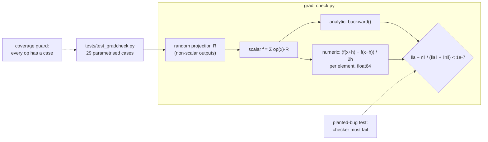

The fused loss, as a single graph node:

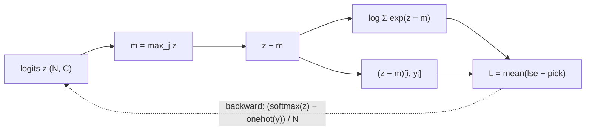

### Notes

- **Plan vs reality: the error metric changed.** The plan specified
  element-wise relative error with `h = 1e-6`. GELU failed at `1.8e-5`. The
  investigation showed the analytic GELU gradient matches complex-step
  differentiation (`f(x + iε).imag / ε`, exact to machine precision) to
  `4e-16`, so the gradient was right and the *metric* was wrong: GELU's
  derivative crosses zero near `x ≈ −0.75`, the element-wise denominator
  vanishes there, and finite-difference round-off (`~ε/h`) reads as a large
  relative error. Two changes followed:
  - `h = 1e-5 ≈ ε^{1/3}` balances truncation error `O(h²)` against
    round-off `O(ε/h)` (measured: `1e-5` gives `3.6e-11` max abs error on
    GELU; `1e-6` gives `3.5e-10`; `1e-7` gives `4.3e-9`).
  - Norm-wise relative error `‖a − n‖ / (‖a‖ + ‖n‖)`, which is
    scale-invariant and immune to individual near-zero entries.

  With these, the worst case across all 29 checks is `1.1e-10`; the test
  threshold is `1e-7`, three orders of magnitude of headroom, yet a planted
  bug (`d/dx x² = x`) produces an error above `0.1`.
- **ReLU's kink.** Inputs to kinked ops are drawn with `|x| ≥ 0.1 ≫ h`. At
  exactly 0 we use subgradient 0. This is a deliberate, documented choice;
  for real-valued data the kink has measure zero.
- **Random projection rather than `.sum()`.** `Σ op(x)` only verifies the
  column sums of the Jacobian (`Jᵀ·1`); a bug that permutes or mixes
  gradient entries would pass. `Σ op(x)·R` with Gaussian `R` verifies `JᵀR`,
  which catches such bugs with probability 1.
- **Coverage guard.** `test_every_public_op_is_covered` fails if a
  differentiable op is added without a corresponding gradient-check case.
- One command for the whole suite: `uv run pytest tests/test_gradcheck.py`.

---

## Phase 3 — Layers, mask-aware optimizers, masked-weight correctness

### Plan

**Goal:** composable layers and optimizers whose behaviour under masking is
*specified*, implemented in one place, and proven by tests. This is the
Part 1 correctness requirement and the foundation of Part 3.

**Where the mask lives.** On the `Parameter` itself (`param.mask`, a boolean
array, `None` for never-prunable parameters such as biases). One source of
truth: the layer reads it in the forward pass, the optimizer reads it in the
update, the pruner writes it. Nothing can disagree about which weights are
alive.

**What is "the gradient of a masked weight"?** The layer computes with the
*effective* weight `W_eff = W ⊙ M`. By the chain rule

    ∂L/∂W = ∂L/∂W_eff ⊙ M

so a masked entry's parameter gradient is **exactly 0**, produced by the
autodiff engine itself, not by a post-hoc hack. That is the right answer for
the *parameter*: `W_ij` for a pruned connection has no influence on the loss
(the forward pass multiplies it by an exact zero), so its derivative is 0.

But it is *not* the only useful quantity. `∂L/∂W_eff` at a masked position
is generally non-zero; it is the answer to "how much would the loss change if
this connection existed?", which is exactly what regrowth needs. The layer
marks `W_eff` with `retain_grad()` so both are available:

| Quantity | Value at a masked entry | Used by |
|---|---|---|
| `W.grad = ∂L/∂W` | exactly `0` | optimizer |
| `W_eff.grad = ∂L/∂(W⊙M)` | dense, generally `≠ 0` | regrowth criterion (Phase 6) |

**Why a zero gradient alone is not enough.** A zero gradient does not stop
a momentum optimizer: Adam's update is `m̂ / (√v̂ + ε)`, and `m` still carries
momentum from before the prune, so a "pruned" weight keeps moving. The
optimizer contract therefore is:

1. **Masked entries are not updated at all**: no parameter step, no decay
   of `m`/`v`, no weight decay, no step-count increment. After every step
   the optimizer re-asserts `W[~M] = 0.0` exactly.
2. **Optimizer state for a pruned entry is frozen and inert.** It is never
   read while the entry is pruned.
3. **On revival** (mask goes `0 → 1`) the entry's `m`, `v` and **its own
   step counter** are reset to zero, and the weight starts from `0.0`.
   Revival is *detected by the optimizer* by diffing the current mask against
   the mask it saw last step, so no caller can forget to notify it.

Point 3's per-element step counter is the subtle part. Adam's bias
correction divides by `1 − β^t`. If we reset `m, v` but keep the *global*
`t` (large), then on the first step after revival

    m̂ = (1−β₁)g,  v̂ = (1−β₂)g²   ⇒   |Δw| = lr·(1−β₁)/√(1−β₂) = lr·0.1/√0.001 ≈ 3.16·lr

a 3× oversized first step for every revived connection. With a per-element
counter restarted at `t = 1`, `m̂ = g`, `v̂ = g²` and `|Δw| = lr`, exactly the
behaviour of a freshly initialised Adam parameter.

**Layers.** `Module` (recursive parameter discovery, train/eval),
`Linear(in, out)` holding `weight (in, out)` with a mask and `bias (out,)`,
`ReLU/Tanh/GELU` modules, `Sequential`, `MLP(sizes)`.

**Initialisation.** He (Kaiming) normal, `std = √(2 / fan_in)`, for layers
followed by ReLU: ReLU zeroes half its inputs, so the factor 2 keeps the
forward activation variance constant layer to layer. The output layer
(followed by softmax, not ReLU) uses Xavier/Glorot uniform,
`U(±√(6/(fan_in+fan_out)))`, which keeps logits at unit scale. Biases start
at 0. The justification is verified empirically in Phase 4.

**Tests (`tests/test_masking.py`), contrasting with a naive baseline:**

- forward: masked entries contribute exactly nothing, even if someone writes
  a non-zero value into the underlying storage;
- gradient: `W.grad` is exactly 0 at masked entries; `W_eff.grad` is dense
  and matches finite differences of the *unmasked* network;
- 50 Adam steps after pruning: pruned weights are bitwise `0.0` throughout,
  and their `m`, `v`, `t` are bitwise unchanged;
- naive "mask the gradient only" Adam: pruned weights drift away from 0
  (committed as evidence of the bug);
- revival: first update `|Δw| ≤ lr`; naive global-step reset gives `≈ 3.16·lr`;
- same set of guarantees for SGD with momentum.

### Architecture

Who owns what during one training step with a pruned layer:

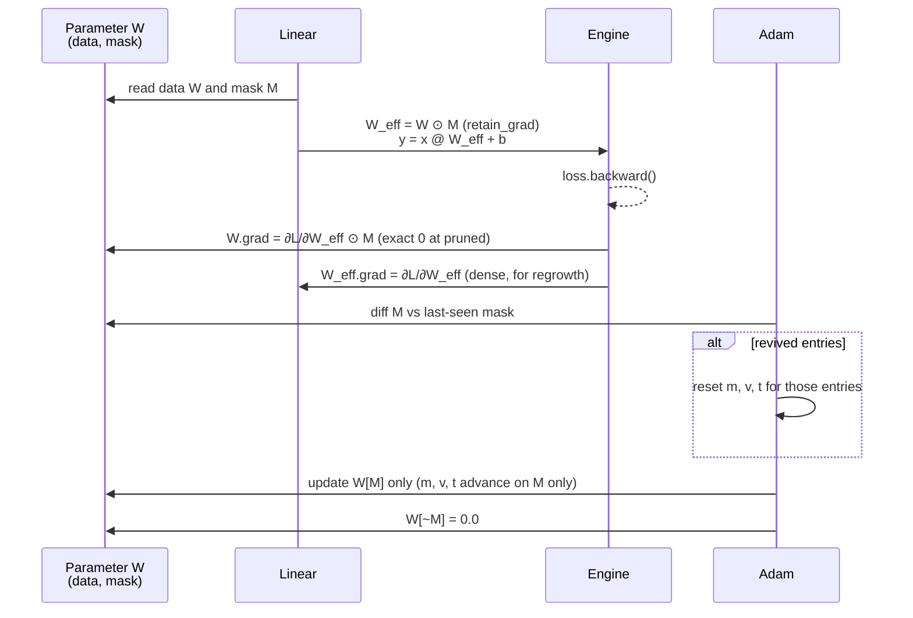

State of one connection across its life:

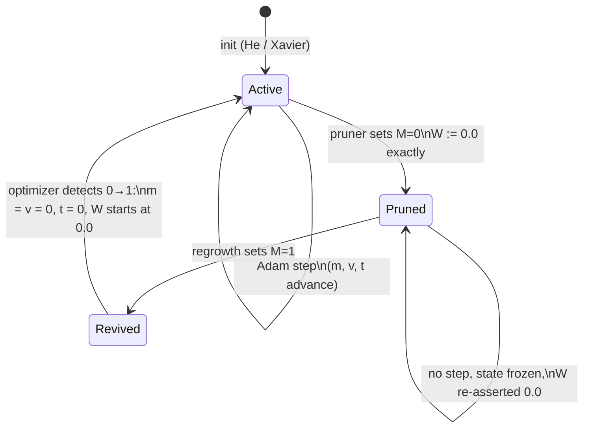

Module hierarchy:

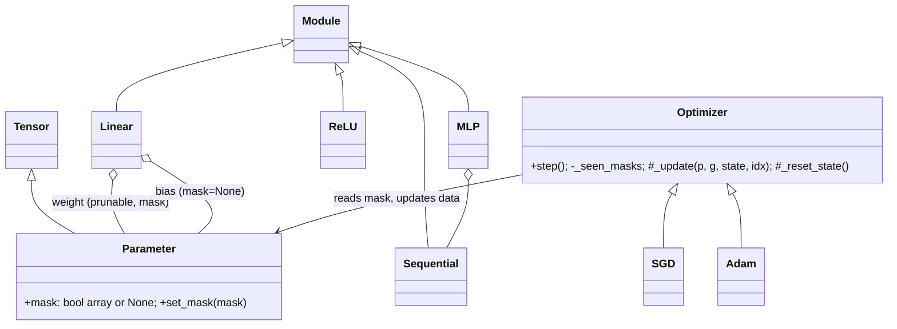

### Notes

- **The evidence matched the derivation exactly** (`scripts/masking_evidence.py`
  → `results/masking_evidence.csv`): mask-aware Adam's first post-revival
  step is `1.0000·lr`; the global-step variant gives `3.1522·lr` (theory:
  `3.162·lr` as `t → ∞`; we revive at `t ≈ 5050`); the no-reset variant
  steps `−0.8·lr` (stale `m ≈ +1` blended with new `g = −1`:
  `0.9·1 + 0.1·(−1) = 0.8`); gradient-only masking drifts to `|w| = 0.069`.
  DESIGN.md §1 reproduces the table.
- **Why the optimizer detects revival itself** instead of exposing
  `optimizer.on_revive(...)`: a notification API is something the pruner
  could forget to call (or call with the wrong indices). Diffing the mask
  that is already the single source of truth makes the wrong state
  unreachable.
- **Two layers of protection for "real zeros":** `Parameter.set_mask`
  writes `0.0` into pruned storage, *and* `Linear` multiplies by the mask in
  the forward pass. The test writes `1e6` into pruned storage to show the
  second layer alone suffices for the forward pass; the optimizer
  re-zeroing guarantees the first for the stored weights (which matters for
  the sparse CSR export in Phase 7: nnz of storage = nnz of the mask).
- **Fast path.** When a mask is all-`True` the optimizer indexes with
  `...` (views) instead of a boolean mask (copies), so dense training pays
  nothing for mask support.
- **Test-only naive optimizers** (`MaskUnawareAdam`, `StaleStateAdam`,
  `GlobalStepAdam`) live in `tests/test_masking.py`. They are subclasses
  that each remove exactly one piece of the contract, so each failure is
  attributable to one decision.
- CSVs are written with `\n` line endings (the default `csv` dialect writes
  `\r\n`, which `.gitattributes` would otherwise renormalise).

---

## Phase 4 — MNIST pipeline, training loop, dense baseline

### Plan

**Goal:** train the Part 3 network *densely* with the Part 1 engine and
Part 3 optimizer, with a learning curve, no NaNs, and a single reproducible
command.

- **Data.** `sklearn.datasets.fetch_openml("mnist_784", parser="liac-arff",
  as_frame=False)` (the only scikit-learn call in the project), cached once
  to `data/mnist.npz` so later runs are offline and fast. OpenML's ordering is
  the canonical 60k train / 10k test split; the last 5k of train are held out
  as **validation** (used for monitoring and any tuning), and the test set is
  touched only for reported numbers. Pixels are scaled to `[0, 1]` and
  standardised with the *training-set* mean and std (no test leakage).
- **Model.** LeNet-300-100 (`784-300-100-10`, ReLU): 266,200 weights, the
  standard architecture in the pruning literature (Han et al. 2015; Lee et
  al. 2019), so our numbers are comparable to published ones.
- **Training loop** (`train/loop.py`): seeded shuffling per epoch,
  mini-batches, `zero_grad → forward → loss → backward → step`, an optional
  per-step callback (the hook the pruner will use in Phase 5), per-epoch
  evaluation under `no_grad()`, and a **NaN/Inf guard** that raises
  immediately with the step number instead of silently training on garbage.
- **Logging.** Per-epoch train loss/acc, val loss/acc to CSV; a learning-curve
  plot. `scripts/train_dense.py` reproduces Part 2 in one command.
- **Precision.** Training in float32 (half the memory traffic of float64,
  matching what any real deployment would do); gradient checks stay float64.
- **Initialisation evidence.** Record the loss at step 0: with Xavier output
  layer and He hidden layers it should be ≈ `ln(10) = 2.303`.

### Architecture

```mermaid
flowchart LR
    subgraph data.py
        O[("OpenML<br/>mnist_784")] -->|"fetch_openml<br/>(only sklearn call)"| C[("data/mnist.npz<br/>SHA-256 verified")]
        C --> S["split 55k / 5k / 10k"] --> N["÷255, standardise<br/>with TRAIN mean/std"]
    end
    N --> MB["iterate_minibatches<br/>(seeded permutation)"]
    subgraph loop.py ["loop.py — one step"]
        MB --> Z["zero_grad"] --> F["forward"] --> L["softmax-CE"]
        L --> G{"finite?"}
        G -- no --> X["raise FloatingPointError"]
        G -- yes --> B["backward"] --> ST["optimizer.step<br/>(lr from cosine schedule)"]
        ST --> CB["step_callback(step)<br/>← pruner hooks in here (Phase 5)"]
    end
    CB --> EV["per epoch: evaluate(val) under no_grad<br/>+ epoch_callback metrics"]
    EV --> OUT[("history.csv<br/>learning_curve.png<br/>summary.json")]
```

### Results (`results/part2/`, seed 0)

| | |
|---|---|
| Architecture | 784-300-100-10, ReLU, 266,610 parameters |
| Optimizer | Adam, lr 1e-3, cosine decay to 1e-5, batch 128, 20 epochs |
| Test accuracy | **98.30 %** (98.36 % before the Phase 5 Adam rewrite; see note) |
| Initial validation loss | 3.11 |
| NaNs | none (the loop would have raised) |
| Wall time | ~14 s on an Apple-silicon laptop (pure NumPy; ~33 s before the Phase 5 Adam speed-up) |

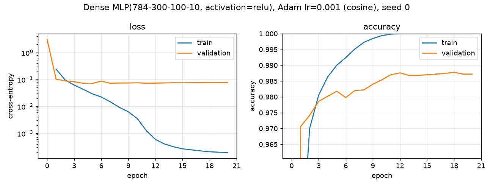

### Notes

- **Plan vs reality: the initial loss is 3.11, not `ln 10 = 2.30`.** The
  plan predicted chance-level loss. It is higher because Xavier on the output
  layer gives logits with variance `σ² ≈ fan_in · Var[h] · 2/(fan_in+fan_out)
  ≈ 100 · 1 · 2/110 ≈ 1.8` (He-initialised hidden layers keep `E[h²] ≈ 1`;
  see `test_he_init_preserves_activation_scale_through_relu_layers`). For
  Gaussian logits, expected cross-entropy is ≈ `ln C + σ²/2 ≈ 2.30 + 0.9 = 3.2`.
  This is a healthy start: the softmax is not saturated (gradients flow),
  and validation accuracy is 97 % after one epoch. A smaller output init
  would lower the starting loss but change nothing that matters.
- **Plan vs reality: added cosine LR decay.** With a constant learning rate
  the validation accuracy jittered by ±0.2 % epoch to epoch (first run:
  98.00 % test, val curve bouncing between 97.8 % and 98.3 %). That jitter is
  the same order as the differences between pruning criteria we want to
  measure in Phase 8, so the end-of-training noise floor matters more than
  peak accuracy. Cosine decay to 1 % of the base rate settles the model:
  98.36 % test, validation flat at 98.6 % for the last six epochs.
- **Initialisation choices, justified empirically.** He-normal for the two
  ReLU layers (`Var = 2/fan_in` compensates for ReLU discarding half the
  signal; the test shows the second moment stays within 1.5× over 6 layers)
  and Xavier-uniform for the output layer (balanced forward/backward
  variance for a linear pre-softmax layer). Biases at 0. No NaNs were
  observed in any run; the NaN guard is tested by injecting `inf`.
- **Train-only normalisation statistics** prevent test-set leakage; the
  test split is evaluated only after training.
- **Data provenance.** `fetch_openml` output is checked against a SHA-256
  of the raw arrays, so if OpenML ever re-ordered or re-encoded the dataset
  the run would fail loudly rather than silently produce different numbers.
- Train accuracy reaches 100 % and validation loss flattens: the dense
  model is over-parameterised for MNIST, which is the premise of pruning.

---

## Phase 5 — Self-pruning: importance criteria, cubic schedule, pruner

### Plan

**Goal:** the same network, trained so that it removes its own least
important connections during training and ends at an exact target sparsity.

**1. Importance = predicted loss increase if removed.** Removing weight
`wᵢ` is the perturbation `δw = −wᵢ eᵢ`. A second-order Taylor expansion of
the loss around the current weights gives

    ΔLᵢ ≈ gᵢ·δwᵢ + ½ Hᵢᵢ δwᵢ² = −gᵢ wᵢ + ½ Hᵢᵢ wᵢ²

(diagonal Hessian, the Optimal Brain Damage assumption). Criteria
implemented, all behind one `Criterion` interface (higher score = keep):

| name | score | rationale |
|---|---|---|
| `magnitude` | `|w|` | baseline: assumes every weight has the same curvature and zero gradient |
| `taylor1` | `|w · ḡ|` | first-order term; `ḡ` = EMA of minibatch gradients (β = 0.99, ~100 steps) |
| `fisher` | `½ w² · EMA(g²)` | second-order term with the Hessian diagonal approximated by the gradient second moment (empirical-Fisher style) |
| `taylor2` | `|−w·ḡ + ½ w² · EMA(g²)|` | both terms of the expansion |

Why EMAs: a single minibatch gradient is dominated by sampling noise;
averaging over ~100 steps estimates the *expected* gradient (for `taylor1`)
and its second moment (for `fisher`). Which criterion is "ours" will be
decided **on the validation set** before the Phase 8 test-set sweep, so the
choice cannot be tuned on the numbers we report.

**2. Schedule.** Zhu & Gupta (2017) cubic ramp, pruning every `Δ = 100` steps:

    s(t) = s_f + (s_i − s_f)(1 − (t − t₀)/(t_end − t₀))³,   t₀ ≤ t ≤ t_end

Steep at first, when the dense network is most redundant and each removal
costs least; flat near the end, when every remaining weight matters and the
network needs time to recover between prune events. Timeline (20 epochs,
430 steps per epoch): 1 dense warm-up epoch (EMAs fill, weights leave their
random init), pruning from epoch 1 to 12, 8 epochs of fine-tuning with a
fixed mask. The cosine LR keeps decaying throughout.

**3. Allocation.** Global ranking across layers with exact counts:
`n_keep = round((1 − s) · n_weights)`. Global is principled for the
loss-based criteria (their scores are all in units of loss, so they are
comparable across layers) and lets the method decide that the 235k-weight
first layer is far more redundant than the 1k-weight output layer. A
per-layer floor (`min_density = 1 %`) prevents a layer from collapsing
entirely. Masks are monotone during pruning (a pruned weight stays pruned;
revival is Phase 6's job). Biases (410 parameters) are never pruned and are
reported separately.

**4. Honest masking.** `Parameter.set_mask` writes exact zeros; Phase 3
guarantees the optimizer keeps them so. The pruner checks after every event
that the achieved sparsity of the *stored weights* (not the mask) equals the
target exactly.

### Architecture

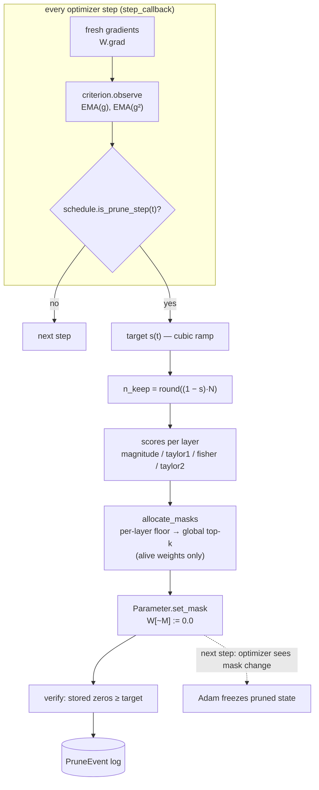

Training timeline (20 epochs × 430 steps):

```mermaid
gantt
    dateFormat X
    axisFormat %s
    title Steps
    section Phase
    dense warm-up (EMAs fill)         :0, 430
    cubic pruning, event every 100    :430, 5130
    fine-tune with fixed mask         :5130, 8600
    section LR
    cosine decay 1e-3 → 1e-5          :0, 8600
```

### Results

`results/part3/fisher_s90/` (seed 0): **98.28 % test accuracy at exactly
90.00 % sparsity** (26,620 of 266,200 weights), vs 98.30 % dense: a cost of
0.02 points. The method decided its own per-layer allocation:

| layer | shape | weights | density kept |
|---|---|---:|---:|
| fc1 | 784×300 | 235,200 | 7.1 % |
| fc2 | 300×100 | 30,000 | 30.5 % |
| fc3 | 100×10 | 1,000 | 80.4 % |

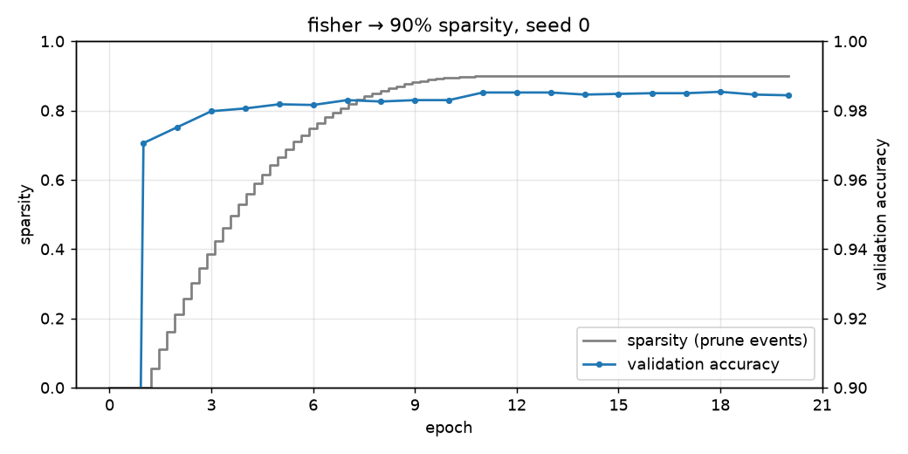

Criterion selection (validation, seeds 100–101) is tabulated in DESIGN.md §2:
Fisher is chosen; magnitude is best at 95 %, gradient criteria at 98 %.

### Notes

- **Plan vs reality: a performance fix mid-phase.** The first selection run
  took ~70–100 s per training run. Profiling showed Adam's boolean-mask
  indexing (`m[mask] = …` copies ~235k elements, about 8 times per step) and
  `β**t` (a full-array `pow` every step) dominating once masks were partial.
  The rewrite uses arithmetic masking, `m += (1−β)(g − m)·a` with
  `a ∈ {0, 1}` (bit-for-bit no-op where `a = 0`, so all masking tests still
  pass unchanged), and a lookup table for `1 − βᵗ`. Microbenchmark on the
  784×300 layer: 11.1 → 1.3 ms per step at 50 % density, 2.6 → 0.5 ms dense.
  A full pruning run now takes ~21 s.
- **Consequence: results regenerated.** The rewrite changes float32
  rounding order, so the Phase 4 dense run was regenerated (98.36 % →
  98.30 %; same seed/config) and the selection run was restarted on the new
  code. Every committed number reproduces from the committed code.
- **Why selection on validation with separate seeds:** choosing the
  criterion by its test accuracy, then reporting test accuracy, would bias
  the comparison in favour of whichever criterion got lucky. The choice is
  made on data and seeds the Phase 8 report never uses.
- **Global allocation in practice:** the first layer, with 88 % of the
  weights, ends at 7 % density while the output layer keeps 80 %. Removing
  a weight from the 1,000-weight output layer costs far more loss than
  removing one of 235k first-layer weights, and the loss-based scores see
  that directly. Phase 6 ablates layer-wise allocation to measure how much
  this matters.
- **A correction made along the way:** an early draft of the magnitude
  critique claimed MNIST's always-blank border pixels give their weights no
  gradient. With global standardisation those pixels are the constant −0.42,
  not 0, so their weights *do* get (bias-like) gradients. The claim was
  dropped from DESIGN.md and a test docstring was corrected, in favour of the
  general argument (Fisher scales `w²` by input activity and output
  sensitivity) plus the measured fact that 37 % of pixels are non-zero in
  under 1 % of images.
- `random` is included as a sanity floor: at 98 % it collapses to 68 %
  validation accuracy, which shows the criteria are doing real work.
