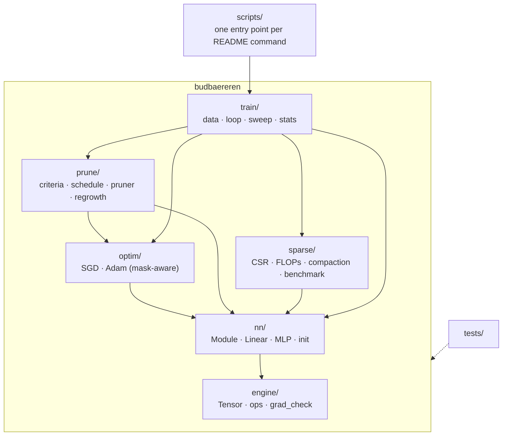
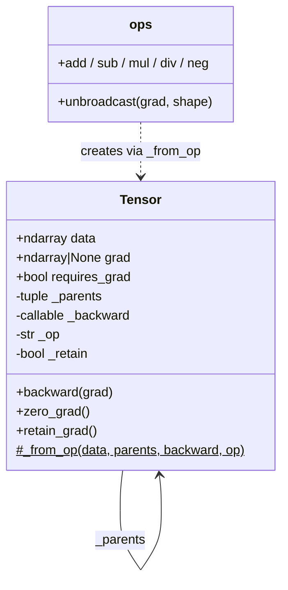
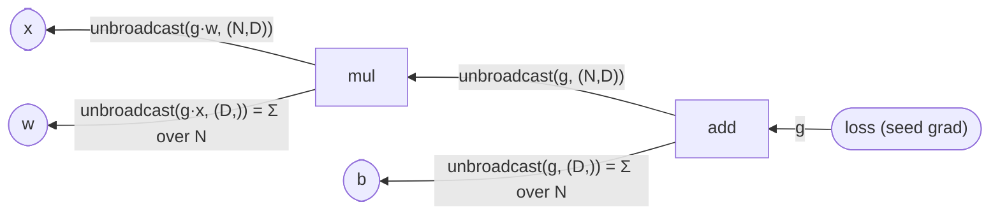

# Budbæreren — Implementation Log

A phase-by-phase record of how Budbæreren was built: what each phase set out
to do, what was actually implemented, and *why* each decision was made.
Every phase starts with a **Plan** (written before any code for that phase)
and ends with **Notes** (written after the phase was finished and tested).

The git history mirrors this document: each phase lives on its own branch
(`phase-N-<slug>`), is merged into `main` with `--no-ff`, and is tagged
`v0.N-<slug>`.

| Phase | Branch | Scope |
|---:|---|---|
| 0 | `phase-0-scaffold` | Repository, tooling, package skeleton |
| 1 | `phase-1-engine-core` | Tensor, computation graph, backward, broadcasting |
| 2 | `phase-2-ops-gradcheck` | Full op set, fused softmax-CE, gradient checking |
| 3 | `phase-3-nn-optim-masking` | Layers, mask-aware SGD/Adam, masked-weight test |
| 4 | `phase-4-training` | MNIST pipeline, training loop, dense baseline |
| 5 | `phase-5-pruning` | Importance criteria, cubic schedule, self-pruning |
| 6 | `phase-6-regrowth` | RigL-style regrowth, mask churn, ablations |
| 7 | `phase-7-sparse-cost` | CSR forward, FLOPs, compaction, wall-clock |
| 8 | `phase-8-evidence` | Pareto sweep, multi-seed baseline, statistics |
| 9 | `phase-9-docs` | README, DESIGN.md, clean-clone reproduction |

---

## Phase 0 — Scaffolding

### Plan

**Goal:** a repository that anyone can clone and run `uv run pytest` on, with
a package layout that already reflects the final architecture so later phases
only *add* files.

Decisions taken up front:

- **Import name `budbaereren`, display name Budbæreren.** `æ` is a legal
  Python identifier (PEP 3131), but pip name normalisation, wheel filenames
  and some tooling handle non-ASCII badly. ASCII import name, Norwegian
  display name.
- **`uv` + `pyproject.toml` + committed `uv.lock`.** The lockfile pins every
  transitive dependency, which is a precondition for "clone and reproduce
  our numbers".
- **Python 3.12** pinned via `.python-version` (the brief requires ≥ 3.10).
- **Runtime dependencies are deliberately minimal:** NumPy (everything),
  Matplotlib (plots), scikit-learn (*only* `fetch_openml` to download MNIST).
  No SciPy — not even for statistics — so there is no question about which
  library did the work.
- **Original brief and private notes are git-ignored.** The repository
  contains only the submission.

### Target architecture

Dependencies only point *downwards*: `engine` knows nothing about layers,
`nn` knows nothing about pruning. This is what lets the masked-weight
guarantees be tested in isolation at each level.

### Notes

- `uv sync && uv run pytest` works from a clean clone; `uv.lock` is committed.
- scikit-learn pulls in SciPy transitively. Because "installed" is not the
  same as "used", `tests/test_library_policy.py` parses every module in
  `budbaereren/` with `ast` and fails if any of torch / tensorflow / jax /
  keras / transformers / scipy / autograd is imported, or if `sklearn` is
  imported anywhere other than `budbaereren/train/data.py`. The policy is
  enforced by CI-style test rather than by promise.
- `seed_everything` seeds the global RNGs as a safety net, but all library
  code takes an explicit `np.random.Generator` so that experiments never
  share hidden RNG state.

---

## Phase 1 — Autodiff core: Tensor, graph, backward, broadcasting

### Plan

**Goal:** a reverse-mode autodiff core that is small enough to explain on a
whiteboard and structured so that *adding an op is one function*.

Design decisions:

1. **`Tensor` wraps a NumPy array** and records `_parents` plus a
   `_backward` closure. Each op's backward is a *pure function*
   `upstream_grad -> tuple(grad_per_parent)`; it never mutates parent state.
   The engine, not the op, owns accumulation. This makes ops trivially
   testable and makes it impossible for an op to forget `+=`.
2. **Gradients accumulate in a per-call dictionary** keyed by node, then
   are written to `.grad`. Leaves *accumulate* across `backward()` calls
   (needs `zero_grad`, like PyTorch); intermediates are only populated when
   explicitly asked for via `retain_grad()` (Phase 3 needs this to read the
   dense gradient of a masked weight for regrowth).
3. **Iterative topological sort.** Recursive DFS hits Python's recursion
   limit on deep graphs; an explicit stack does not.
4. **One `unbroadcast(grad, shape)` helper**, used by every binary op. NumPy
   broadcasting in the forward pass implicitly *copies* a value along new or
   size-1 axes; the adjoint of a copy is a *sum*, so the backward sums the
   upstream gradient over exactly those axes.
5. **Dtype discipline.** Python scalars adopt the dtype of the tensor they
   meet (float32 training stays float32); integer inputs are promoted to
   float64. Gradient checking runs entirely in float64.
6. **`no_grad()` context** so evaluation does not build graphs.

Ops in this phase: `+ − × ÷`, negation, and their reflected forms. The rest
(matmul, reductions, non-linearities, softmax-CE) follow in Phase 2 together
with numerical gradient checking.

### Architecture

How `backward()` walks the graph for `loss = (x * w + b)` with
`x: (N, D)`, `w: (D,)`, `b: (D,)`:

### Notes

- **Why a per-call gradient dictionary instead of `node.grad += ...` inside
  every op?** It removes a whole class of bugs. An op's backward is a pure
  function of the upstream gradient, so it is testable in isolation, and
  accumulation for reused nodes (`x * x`, diamonds) happens in exactly one
  place. `test_reused_node_accumulates_gradient` would fail with `=`.
- **Leaves vs intermediates.** Leaves accumulate across `backward()` calls
  (standard semantics: the optimizer zeroes them). Intermediates are
  overwritten and only stored when `retain_grad()` is set; Phase 3 uses this
  to read `∂L/∂(W⊙M)` — the *dense* gradient of the effective weight — which
  is what regrowth needs, while the parameter itself gets `∂L/∂W = ∂L/∂(W⊙M) ⊙ M`.
- **Graph pruning at construction.** `_from_op` only records parents when
  some parent requires grad and grad mode is on, so constants (data, masks,
  labels) never enter the graph and `no_grad()` evaluation allocates nothing
  but results.
- **Broadcast test independence.** The reference gradient in
  `test_broadcast.py` is computed by scatter-adding each output position
  back to the element it was copied from, *not* by calling `unbroadcast`, so
  the test cannot pass by agreeing with its own bug.
- **`__array_priority__`** makes `ndarray * Tensor` dispatch to
  `Tensor.__rmul__` rather than NumPy trying to broadcast over a Tensor
  object.
