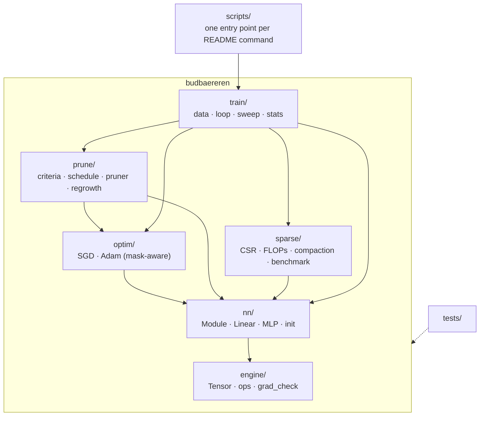

# Budbæreren — Implementation Log

A phase-by-phase record of how Budbæreren was built: what each phase set out
to do, what was actually implemented, and *why* each decision was made.
Every phase starts with a **Plan** (written before any code for that phase)
and ends with **Notes** (written after the phase was finished and tested).

The git history mirrors this document: each phase lives on its own branch
(`phase-N-<slug>`), is merged into `main` with `--no-ff`, and is tagged
`v0.N-<slug>`.

| Phase | Branch | Scope |
|---:|---|---|
| 0 | `phase-0-scaffold` | Repository, tooling, package skeleton |
| 1 | `phase-1-engine-core` | Tensor, computation graph, backward, broadcasting |
| 2 | `phase-2-ops-gradcheck` | Full op set, fused softmax-CE, gradient checking |
| 3 | `phase-3-nn-optim-masking` | Layers, mask-aware SGD/Adam, masked-weight test |
| 4 | `phase-4-training` | MNIST pipeline, training loop, dense baseline |
| 5 | `phase-5-pruning` | Importance criteria, cubic schedule, self-pruning |
| 6 | `phase-6-regrowth` | RigL-style regrowth, mask churn, ablations |
| 7 | `phase-7-sparse-cost` | CSR forward, FLOPs, compaction, wall-clock |
| 8 | `phase-8-evidence` | Pareto sweep, multi-seed baseline, statistics |
| 9 | `phase-9-docs` | README, DESIGN.md, clean-clone reproduction |

---

## Phase 0 — Scaffolding

### Plan

**Goal:** a repository that anyone can clone and run `uv run pytest` on, with
a package layout that already reflects the final architecture so later phases
only *add* files.

Decisions taken up front:

- **Import name `budbaereren`, display name Budbæreren.** `æ` is a legal
  Python identifier (PEP 3131), but pip name normalisation, wheel filenames
  and some tooling handle non-ASCII badly. ASCII import name, Norwegian
  display name.
- **`uv` + `pyproject.toml` + committed `uv.lock`.** The lockfile pins every
  transitive dependency, which is a precondition for "clone and reproduce
  our numbers".
- **Python 3.12** pinned via `.python-version` (the brief requires ≥ 3.10).
- **Runtime dependencies are deliberately minimal:** NumPy (everything),
  Matplotlib (plots), scikit-learn (*only* `fetch_openml` to download MNIST).
  No SciPy — not even for statistics — so there is no question about which
  library did the work.
- **Original brief and private notes are git-ignored.** The repository
  contains only the submission.

### Target architecture

Dependencies only point *downwards*: `engine` knows nothing about layers,
`nn` knows nothing about pruning. This is what lets the masked-weight
guarantees be tested in isolation at each level.
